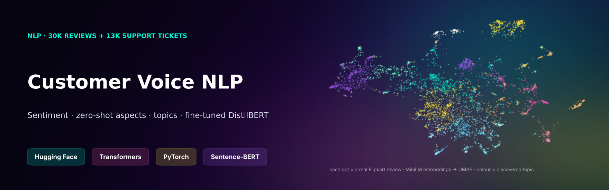
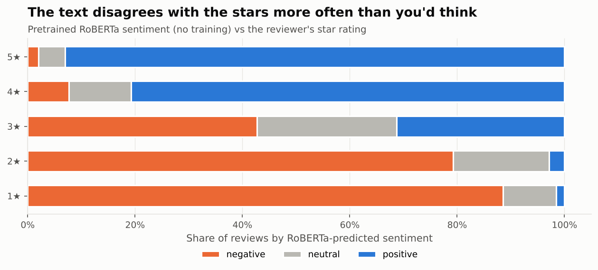
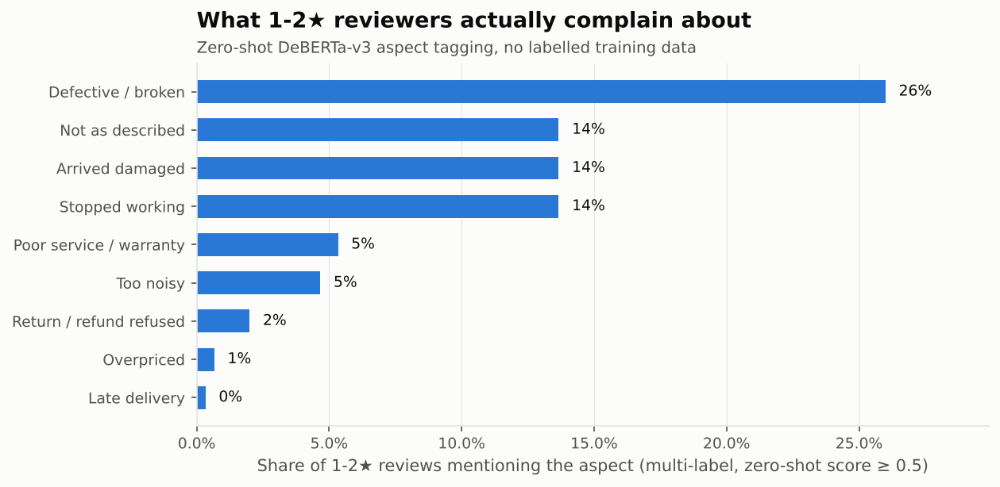
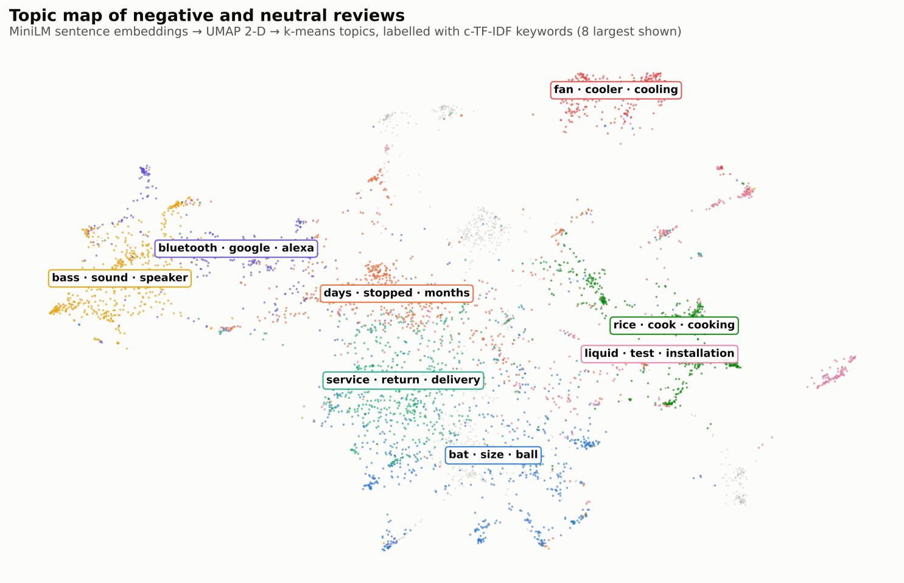
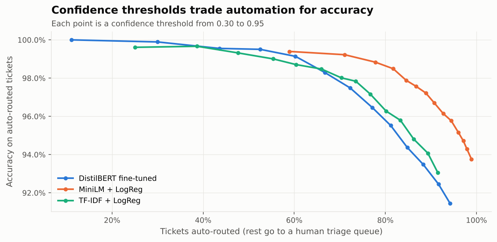

<p align="center"></p>

<p align="center">
  
  
  
  
  
</p>

# Customer Voice NLP: Hugging Face Transformers on Real Indian Reviews and Banking Support Tickets

Two questions every consumer business asks, answered with 🤗 Hugging Face models on **real, public text**:

1. **What are customers really complaining about?** 30K de-duplicated **Flipkart product reviews** (205 products). The tools are pretrained sentiment, rating-text mismatch detection, **zero-shot aspect tagging** and **embedding-based topic discovery**.
2. **Can support tickets be routed automatically?** 13K real banking-app queries (**Banking77**, 77 intents). The comparison runs TF-IDF vs frozen sentence embeddings vs a **fine-tuned DistilBERT**, then sets a **confidence threshold** for safe automation.

| Notebook | |
|---|---|
| [`01_review_analytics.ipynb`](notebooks/01_review_analytics.ipynb) | Flipkart reviews: sentiment, hidden complaints, zero-shot aspects, topic map |
| [`02_support_intent_routing.ipynb`](notebooks/02_support_intent_routing.ipynb) | Banking77: three model families, auto-routing trade-off, confusions |

> **Data:** `ml-hub/flipkart-reviews` and `PolyAI/banking77` (CC-BY-4.0) are loaded from the Hugging Face Hub at run time and not redistributed here.
> Everything runs on a **4-core CPU** (no GPU). Slow transformer passes are cached by `src/precompute.py` and `src/intent.py`.

---

## Findings

| | Finding |
|---|---|
| 🤖 | **A pretrained transformer with zero training matches a supervised model.** On a stratified sample of 6,000 reviews (1,200 per star), `cardiffnlp/twitter-roberta-base-sentiment-latest` reaches **macro-F1 0.651** vs **0.643** for TF-IDF + logistic regression trained on 23K star-labelled reviews. |
| ⭐ | **Stars and text disagree in the middle.** 43% of 3★ reviews read as *negative*, 31% as positive. Text-based sentiment separates the "it's OK, but…" reviews that a star average hides. |
| 🕵️ | **Hidden complaints:** some 4–5★ reviews are clearly negative in text (*"product is good but the worst experience with delivery boy's behaviour… the box was half opened"*). These are invisible to any star-based dashboard. The notebook lists them. |
| 🏷️ | **Zero-shot aspects on 300 one- and two-star reviews, with no labelling:** *defective/broken* 26%, *stopped working* 14%, *arrived damaged* 14%, *not as described* 14%, *poor service/warranty* 5%; late delivery and price are rare. **52% name no specific reason** ("very bad product, don't buy"), which argues for structured reason prompts in the review form. By category: **food processors** 56% defective and 40% arrived damaged (a packaging problem); **kitchen chimneys** 27% stopped working and 18% poor service/warranty (an after-sales problem); **beauty & fragrance** 24% *not as described*. |
| 🗺️ | **12 complaint topics discovered without labels** (MiniLM embeddings → k-means → c-TF-IDF). Examples: *stopped working after days/months*, *service · return · delivery*, *bass · sound · speaker*, *fan · cooler · cooling*, *transfer speed · slow* (hard disks), *perfume · smell · long-lasting*. |
| 🏦 | **Ticket routing:** frozen **MiniLM embeddings + logistic regression score 93.2%** accuracy on 77 intents (2 min to train), vs 89.1% for TF-IDF. A **DistilBERT fine-tuned for 2 CPU epochs** reaches 89.0% after 16 min. It's under-trained on this budget, which is a useful cost/benefit result: the Banking77 paper reports about 93% for fully fine-tuned BERT, so fine-tuning pays off once a GPU and more epochs are available. |
| 🚦 | **Safe automation:** at confidence ≥ 0.80 the best model **auto-routes 82% of tickets at 98.5% accuracy**. The other 18% go to human triage. Remaining errors sit between genuinely overlapping intents (*pending* vs *not received* transfers, *card arrival* vs *delivery estimate*). |

<p align="center">
  
  
</p>
<p align="center">
  
  
</p>

---

## Models used

| Task | 🤗 Model | Technique |
|---|---|---|
| Sentiment | `cardiffnlp/twitter-roberta-base-sentiment-latest` | `pipeline("sentiment-analysis")`, length-sorted batching for CPU speed |
| Aspects | `MoritzLaurer/deberta-v3-base-zeroshot-v2.0` | `pipeline("zero-shot-classification")`, multi-label, single-concept hypotheses |
| Topics | `sentence-transformers/all-MiniLM-L6-v2` | embeddings → UMAP (2-D map) → k-means → **c-TF-IDF** keywords (the BERTopic idea, implemented from scratch) |
| Intents | `distilbert-base-uncased` | full fine-tuning with the 🤗 `Trainer` (2 epochs, CPU) |
| Intents | `all-MiniLM-L6-v2` + logistic regression | frozen encoder + linear head |

**Lessons learned building it:**
- On CPU, sort texts by length before batching. Random batches pad every short review to the longest in the batch, which made the first sentiment run far slower than necessary.
- Zero-shot NLI needs **single-concept hypotheses**. "The product is defective *or* poor quality" fired on 90% of complaints and "delivery was late *or* the courier was bad" on 0%. Nine single-concept hypotheses made the tags discriminative.

## Run it

```bash
pip install torch --index-url https://download.pytorch.org/whl/cpu
pip install -r requirements.txt
python src/precompute.py    # sentiment + zero-shot + embeddings, cached (CPU: ~30 min)
python src/intent.py        # Banking77: three models, cached predictions (CPU: ~20 min)
jupyter nbconvert --to notebook --execute --inplace notebooks/*.ipynb
pytest -q                   # pure helpers: category rules, c-TF-IDF, mismatch logic, routing curve
```

## Structure

```
├── notebooks/                 01 review analytics · 02 support intent routing (executed)
├── src/
│   ├── reviews.py             data loading, HF pipelines (cached), c-TF-IDF, mismatch detection
│   ├── intent.py              TF-IDF / MiniLM / DistilBERT training, routing curve, confusions
│   ├── precompute.py          runs the slow transformer passes once
│   └── charts.py
├── reports/                   model comparison, topics, aspects by category
├── images/ · assets/
└── tests/
```

---

**Author:** Husein Ghadiali · Data Analyst · I built a text-mining pipeline over 10K+ patient reviews that helped cut complaints 12% · [LinkedIn](https://linkedin.com/in/husein-ghadiali)
